# DOKUMENTASI RESMI BASIS DATA: ERD DAN LRS
## Proyek: BUBEE (E-Commerce & Reseller Tumbler Platform)

---

## 1. Ringkasan Eksekutif & Gambaran Umum Basis Data

Dokumentasi ini disusun berdasarkan **analisis menyeluruh dan faktual** terhadap arsitektur kode sumber, file migration, model Eloquent, dan database riil MySQL (`bubee_db`) pada aplikasi **Bubee**.

- **Bahasa Pemrograman & Framework**: PHP 8.2+ / Laravel 11.x
- **Basis Data**: MySQL / MariaDB (Nama Basis Data: `bubee_db`)
- **Total Tabel di Database**: 30 Tabel
- **Tabel Entitas Domain Bisnis**: 22 Tabel Utama
- **Tabel Utilitas Framework Laravel**: 8 Tabel (`migrations`, `sessions`, `cache`, `cache_locks`, `jobs`, `job_batches`, `failed_jobs`, `password_reset_tokens`)
- **Total Relasi Foreign Key Terverifikasi**: 29 Relasi Fisik

### Pengelompokan 5 Modul Arsitektur Bisnis:

1. **Modul Pengguna & Keamanan (3 Tabel)**: `users`, `otps`, `activity_logs`
2. **Modul Katalog & Varian Produk (4 Tabel)**: `products`, `product_variants`, `product_images`, `product_prices`
3. **Modul Transaksi & Checkout (5 Tabel)**: `carts`, `vouchers`, `orders`, `order_items`, `notification_logs`
4. **Modul Layanan Pasca Penjualan & Sistem (5 Tabel)**: `returs`, `retur_items`, `reviews`, `faqs`, `settings`
5. **Modul Logistik Pergudangan & Inventori (5 Tabel)**: `stock_mutations`, `penerimaan`, `penerimaan_items`, `opname_sesi`, `opname_items`

---

## 2. Entity Relationship Diagram (ERD)

Diagram ERD di bawah ini memodelkan seluruh entitas, atribut penting (PK, FK, UK), tipe data, dan derajat kardinalitas relasi antar entitas (1:N) berdasarkan database aktual.

File visual diagram ERD resolusi tinggi:
- **Format Gambar Resolusi Tinggi**: `ERD.png`
- **Format Dokumen PDF Landscape**: `ERD.pdf`

```mermaid
erDiagram
    USERS ||--o{ ACTIVITY_LOGS : "memiliki"
    PRODUCTS ||--o{ CARTS : "memiliki"
    USERS ||--o{ CARTS : "memiliki"
    PRODUCT_VARIANTS ||--o{ CARTS : "memiliki"
    ORDERS ||--o{ NOTIFICATION_LOGS : "memiliki"
    OPNAME_SESI ||--o{ OPNAME_ITEMS : "memiliki"
    PRODUCT_VARIANTS ||--o{ OPNAME_ITEMS : "memiliki"
    USERS ||--o{ OPNAME_SESI : "memiliki"
    ORDERS ||--o{ ORDER_ITEMS : "memiliki"
    PRODUCTS ||--o{ ORDER_ITEMS : "memiliki"
    PRODUCT_VARIANTS ||--o{ ORDER_ITEMS : "memiliki"
    USERS ||--o{ ORDERS : "memiliki"
    VOUCHERS ||--o{ ORDERS : "memiliki"
    USERS ||--o{ PENERIMAAN : "memiliki"
    PENERIMAAN ||--o{ PENERIMAAN_ITEMS : "memiliki"
    PRODUCTS ||--o{ PENERIMAAN_ITEMS : "memiliki"
    PRODUCT_VARIANTS ||--o{ PENERIMAAN_ITEMS : "memiliki"
    PRODUCTS ||--o{ PRODUCT_IMAGES : "memiliki"
    PRODUCTS ||--o{ PRODUCT_PRICES : "memiliki"
    PRODUCTS ||--o{ PRODUCT_VARIANTS : "memiliki"
    ORDER_ITEMS ||--o{ RETUR_ITEMS : "memiliki"
    RETURS ||--o{ RETUR_ITEMS : "memiliki"
    ORDERS ||--o{ RETURS : "memiliki"
    USERS ||--o{ RETURS : "memiliki"
    ORDERS ||--o{ REVIEWS : "memiliki"
    PRODUCTS ||--o{ REVIEWS : "memiliki"
    USERS ||--o{ REVIEWS : "memiliki"
    PRODUCTS ||--o{ STOCK_MUTATIONS : "memiliki"
    PRODUCT_VARIANTS ||--o{ STOCK_MUTATIONS : "memiliki"

    ACTIVITY_LOGS {
        bigint id PK
        bigint actor_id FK
        varchar aksi
        varchar kategori
        varchar level
        varchar subjek
        text keterangan
        varchar ip
        varchar tautan
        timestamp created_at
        timestamp updated_at
    }

    CARTS {
        bigint id PK
        bigint user_id FK
        bigint product_id FK
        bigint variant_id FK
        int qty
        timestamp created_at
        timestamp updated_at
    }

    FAQS {
        bigint id PK
        varchar topik
        varchar pertanyaan
        text jawaban
        int urutan
        tinyint is_active
        timestamp created_at
        timestamp updated_at
    }

    NOTIFICATION_LOGS {
        bigint id PK
        varchar tipe
        varchar tujuan
        text pesan
        varchar status
        text response
        bigint order_id FK
        timestamp created_at
        timestamp updated_at
    }

    OPNAME_ITEMS {
        bigint id PK
        bigint sesi_id FK
        bigint variant_id FK
        int snapshot
        int fisik
        varchar foto
        timestamp created_at
        timestamp updated_at
    }

    OPNAME_SESI {
        bigint id PK
        bigint user_id FK
        varchar cakupan
        varchar status
        timestamp created_at
        timestamp updated_at
    }

    ORDER_ITEMS {
        bigint id PK
        bigint order_id FK
        bigint product_id FK
        bigint variant_id FK
        int qty
        int harga_satuan
        int subtotal
        varchar tipe_harga
        timestamp created_at
        timestamp updated_at
    }

    ORDERS {
        bigint id PK
        bigint user_id FK
        varchar kode UK
        int total_produk
        int ongkir
        varchar ongkir_sumber
        int berat_tagih_gram
        bigint voucher_id FK
        int diskon
        int total_bayar
        varchar kurir
        varchar layanan
        varchar resi
        varchar alasan_batal
        varchar status
        text alamat
        varchar kota_tujuan
        varchar city_id
        varchar nama_penerima
        varchar hp_penerima
        varchar bukti_bayar
        varchar snap_token
        timestamp created_at
        timestamp updated_at
    }

    OTPS {
        bigint id PK
        varchar email
        varchar kode_hash
        tinyint percobaan
        timestamp kedaluwarsa_at
        timestamp dipakai_at
        timestamp created_at
        timestamp updated_at
    }

    PENERIMAAN {
        bigint id PK
        bigint user_id FK
        varchar no_surat_jalan
        varchar supplier
        varchar status
        timestamp created_at
        timestamp updated_at
    }

    PENERIMAAN_ITEMS {
        bigint id PK
        bigint penerimaan_id FK
        bigint product_id FK
        bigint variant_id FK
        int qty_klaim
        int qty_lolos
        int qty_rusak
        varchar catatan
        timestamp created_at
        timestamp updated_at
    }

    PRODUCT_IMAGES {
        bigint id PK
        bigint product_id FK
        varchar foto
        varchar judul
        int urutan
        timestamp created_at
        timestamp updated_at
    }

    PRODUCT_PRICES {
        bigint id PK
        bigint product_id FK
        varchar level
        int min_qty
        int price
        timestamp created_at
        timestamp updated_at
    }

    PRODUCT_VARIANTS {
        bigint id PK
        bigint product_id FK
        varchar ukuran
        varchar warna
        int stok
        int harga_enduser
        int harga_reseller
        int berat_gram
        varchar sku UK
        timestamp created_at
        timestamp updated_at
    }

    PRODUCTS {
        bigint id PK
        varchar nama
        text deskripsi
        varchar kategori
        varchar foto
        int berat_gram
        int panjang_cm
        int lebar_cm
        int tinggi_cm
        int stok
        int harga_enduser
        int harga_reseller
        int min_reseller
        tinyint is_active
        timestamp created_at
        timestamp updated_at
        timestamp deleted_at
    }

    RETUR_ITEMS {
        bigint id PK
        bigint retur_id FK
        bigint order_item_id FK
        int qty
        timestamp created_at
        timestamp updated_at
    }

    RETURS {
        bigint id PK
        bigint order_id FK
        bigint user_id FK
        text alasan
        varchar kategori
        varchar foto
        varchar status
        text catatan_admin
        timestamp created_at
        timestamp updated_at
    }

    REVIEWS {
        bigint id PK
        bigint product_id FK
        bigint user_id FK
        bigint order_id FK
        tinyint rating
        text ulasan
        varchar foto
        timestamp created_at
        timestamp updated_at
    }

    SETTINGS {
        bigint id PK
        varchar key UK
        text value
        timestamp created_at
        timestamp updated_at
    }

    STOCK_MUTATIONS {
        bigint id PK
        bigint product_id FK
        bigint variant_id FK
        varchar tipe
        int qty
        int stok_sebelum
        int stok_sesudah
        varchar keterangan
        timestamp created_at
        timestamp updated_at
    }

    USERS {
        bigint id PK
        varchar name
        varchar email UK
        varchar role
        varchar status_reseller
        varchar hp UK
        text alamat
        varchar toko_nama
        varchar nik
        tinyint notif_wa
        varchar ktp_foto
        timestamp email_verified_at
        tinyint daftar_coba
        varchar password
        varchar remember_token
        timestamp created_at
        timestamp updated_at
    }

    VOUCHERS {
        bigint id PK
        varchar kode UK
        varchar nama
        varchar tipe
        int nilai
        int maks_diskon
        int min_belanja
        int kuota
        int terpakai
        varchar khusus
        tinyint is_active
        date berlaku_sampai
        timestamp created_at
        timestamp updated_at
    }
```

---

## 3. Logical Record Structure (LRS)

**LRS (Logical Record Structure)** merupakan hasil transformasi relasional normalisasi (Third Normal Form - 3NF) dari model ERD. Pada LRS:
- Kunci utama ditandai dengan awalan `*` (*Primary Key*)
- Kunci tamu ditandai dengan awalan `**` (*Foreign Key*)
- Hubungan antar-tabel ditunjukkan oleh ketergantungan relasional dari `* PK` menuju `** FK`.

File visual diagram LRS resolusi tinggi:
- **Format Gambar Resolusi Tinggi**: `LRS.png`
- **Format Dokumen PDF Landscape**: `LRS.pdf`

```mermaid
flowchart LR
    subgraph ACTIVITY_LOGS ["ACTIVITY_LOGS"]
        activity_logs_BODY["* id (bigint(20) unsigned)<br/>** actor_id (bigint(20) unsigned)<br/>aksi (varchar(50))<br/>kategori (varchar(20))<br/>level (varchar(10))<br/>subjek (varchar(100))<br/>keterangan (text)<br/>ip (varchar(45))<br/>tautan (varchar(200))<br/>created_at (timestamp)<br/>updated_at (timestamp)"]
    end
    subgraph CARTS ["CARTS"]
        carts_BODY["* id (bigint(20) unsigned)<br/>** user_id (bigint(20) unsigned)<br/>** product_id (bigint(20) unsigned)<br/>** variant_id (bigint(20) unsigned)<br/>qty (int(11))<br/>created_at (timestamp)<br/>updated_at (timestamp)"]
    end
    subgraph FAQS ["FAQS"]
        faqs_BODY["* id (bigint(20) unsigned)<br/>topik (varchar(30))<br/>pertanyaan (varchar(255))<br/>jawaban (text)<br/>urutan (int(11))<br/>is_active (tinyint(1))<br/>created_at (timestamp)<br/>updated_at (timestamp)"]
    end
    subgraph NOTIFICATION_LOGS ["NOTIFICATION_LOGS"]
        notification_logs_BODY["* id (bigint(20) unsigned)<br/>tipe (varchar(255))<br/>tujuan (varchar(255))<br/>pesan (text)<br/>status (varchar(255))<br/>response (text)<br/>** order_id (bigint(20) unsigned)<br/>created_at (timestamp)<br/>updated_at (timestamp)"]
    end
    subgraph OPNAME_ITEMS ["OPNAME_ITEMS"]
        opname_items_BODY["* id (bigint(20) unsigned)<br/>** sesi_id (bigint(20) unsigned)<br/>** variant_id (bigint(20) unsigned)<br/>snapshot (int(11))<br/>fisik (int(11))<br/>foto (varchar(255))<br/>created_at (timestamp)<br/>updated_at (timestamp)"]
    end
    subgraph OPNAME_SESI ["OPNAME_SESI"]
        opname_sesi_BODY["* id (bigint(20) unsigned)<br/>** user_id (bigint(20) unsigned)<br/>cakupan (varchar(50))<br/>status (varchar(20))<br/>created_at (timestamp)<br/>updated_at (timestamp)"]
    end
    subgraph ORDER_ITEMS ["ORDER_ITEMS"]
        order_items_BODY["* id (bigint(20) unsigned)<br/>** order_id (bigint(20) unsigned)<br/>** product_id (bigint(20) unsigned)<br/>** variant_id (bigint(20) unsigned)<br/>qty (int(11))<br/>harga_satuan (int(11))<br/>subtotal (int(11))<br/>tipe_harga (varchar(255))<br/>created_at (timestamp)<br/>updated_at (timestamp)"]
    end
    subgraph ORDERS ["ORDERS"]
        orders_BODY["* id (bigint(20) unsigned)<br/>** user_id (bigint(20) unsigned)<br/>kode (varchar(255))<br/>total_produk (int(11))<br/>ongkir (int(11))<br/>ongkir_sumber (varchar(255))<br/>berat_tagih_gram (int(11))<br/>** voucher_id (bigint(20) unsigned)<br/>diskon (int(11))<br/>total_bayar (int(11))<br/>kurir (varchar(255))<br/>layanan (varchar(255))<br/>... +12 kolom lainnya"]
    end
    subgraph OTPS ["OTPS"]
        otps_BODY["* id (bigint(20) unsigned)<br/>email (varchar(255))<br/>kode_hash (varchar(255))<br/>percobaan (tinyint(3) unsigned)<br/>kedaluwarsa_at (timestamp)<br/>dipakai_at (timestamp)<br/>created_at (timestamp)<br/>updated_at (timestamp)"]
    end
    subgraph PENERIMAAN ["PENERIMAAN"]
        penerimaan_BODY["* id (bigint(20) unsigned)<br/>** user_id (bigint(20) unsigned)<br/>no_surat_jalan (varchar(50))<br/>supplier (varchar(100))<br/>status (varchar(20))<br/>created_at (timestamp)<br/>updated_at (timestamp)"]
    end
    subgraph PENERIMAAN_ITEMS ["PENERIMAAN_ITEMS"]
        penerimaan_items_BODY["* id (bigint(20) unsigned)<br/>** penerimaan_id (bigint(20) unsigned)<br/>** product_id (bigint(20) unsigned)<br/>** variant_id (bigint(20) unsigned)<br/>qty_klaim (int(11))<br/>qty_lolos (int(11))<br/>qty_rusak (int(11))<br/>catatan (varchar(200))<br/>created_at (timestamp)<br/>updated_at (timestamp)"]
    end
    subgraph PRODUCT_IMAGES ["PRODUCT_IMAGES"]
        product_images_BODY["* id (bigint(20) unsigned)<br/>** product_id (bigint(20) unsigned)<br/>foto (varchar(255))<br/>judul (varchar(255))<br/>urutan (int(11))<br/>created_at (timestamp)<br/>updated_at (timestamp)"]
    end
    subgraph PRODUCT_PRICES ["PRODUCT_PRICES"]
        product_prices_BODY["* id (bigint(20) unsigned)<br/>** product_id (bigint(20) unsigned)<br/>level (varchar(20))<br/>min_qty (int(11))<br/>price (int(11))<br/>created_at (timestamp)<br/>updated_at (timestamp)"]
    end
    subgraph PRODUCT_VARIANTS ["PRODUCT_VARIANTS"]
        product_variants_BODY["* id (bigint(20) unsigned)<br/>** product_id (bigint(20) unsigned)<br/>ukuran (varchar(20))<br/>warna (varchar(30))<br/>stok (int(11))<br/>harga_enduser (int(10) unsigned)<br/>harga_reseller (int(10) unsigned)<br/>berat_gram (int(10) unsigned)<br/>sku (varchar(255))<br/>created_at (timestamp)<br/>updated_at (timestamp)"]
    end
    subgraph PRODUCTS ["PRODUCTS"]
        products_BODY["* id (bigint(20) unsigned)<br/>nama (varchar(255))<br/>deskripsi (text)<br/>kategori (varchar(50))<br/>foto (varchar(255))<br/>berat_gram (int(11))<br/>panjang_cm (int(11))<br/>lebar_cm (int(11))<br/>tinggi_cm (int(11))<br/>stok (int(11))<br/>harga_enduser (int(11))<br/>harga_reseller (int(11))<br/>... +5 kolom lainnya"]
    end
    subgraph RETUR_ITEMS ["RETUR_ITEMS"]
        retur_items_BODY["* id (bigint(20) unsigned)<br/>** retur_id (bigint(20) unsigned)<br/>** order_item_id (bigint(20) unsigned)<br/>qty (int(11))<br/>created_at (timestamp)<br/>updated_at (timestamp)"]
    end
    subgraph RETURS ["RETURS"]
        returs_BODY["* id (bigint(20) unsigned)<br/>** order_id (bigint(20) unsigned)<br/>** user_id (bigint(20) unsigned)<br/>alasan (text)<br/>kategori (varchar(30))<br/>foto (varchar(255))<br/>status (varchar(255))<br/>catatan_admin (text)<br/>created_at (timestamp)<br/>updated_at (timestamp)"]
    end
    subgraph REVIEWS ["REVIEWS"]
        reviews_BODY["* id (bigint(20) unsigned)<br/>** product_id (bigint(20) unsigned)<br/>** user_id (bigint(20) unsigned)<br/>** order_id (bigint(20) unsigned)<br/>rating (tinyint(4))<br/>ulasan (text)<br/>foto (varchar(255))<br/>created_at (timestamp)<br/>updated_at (timestamp)"]
    end
    subgraph SETTINGS ["SETTINGS"]
        settings_BODY["* id (bigint(20) unsigned)<br/>key (varchar(255))<br/>value (text)<br/>created_at (timestamp)<br/>updated_at (timestamp)"]
    end
    subgraph STOCK_MUTATIONS ["STOCK_MUTATIONS"]
        stock_mutations_BODY["* id (bigint(20) unsigned)<br/>** product_id (bigint(20) unsigned)<br/>** variant_id (bigint(20) unsigned)<br/>tipe (varchar(255))<br/>qty (int(11))<br/>stok_sebelum (int(11))<br/>stok_sesudah (int(11))<br/>keterangan (varchar(255))<br/>created_at (timestamp)<br/>updated_at (timestamp)"]
    end
    subgraph USERS ["USERS"]
        users_BODY["* id (bigint(20) unsigned)<br/>name (varchar(255))<br/>email (varchar(255))<br/>role (varchar(255))<br/>status_reseller (varchar(255))<br/>hp (varchar(255))<br/>alamat (text)<br/>toko_nama (varchar(60))<br/>nik (varchar(25))<br/>notif_wa (tinyint(1))<br/>ktp_foto (varchar(255))<br/>email_verified_at (timestamp)<br/>... +5 kolom lainnya"]
    end
    subgraph VOUCHERS ["VOUCHERS"]
        vouchers_BODY["* id (bigint(20) unsigned)<br/>kode (varchar(255))<br/>nama (varchar(255))<br/>tipe (varchar(255))<br/>nilai (int(11))<br/>maks_diskon (int(11))<br/>min_belanja (int(11))<br/>kuota (int(11))<br/>terpakai (int(11))<br/>khusus (varchar(255))<br/>is_active (tinyint(1))<br/>berlaku_sampai (date)<br/>... +2 kolom lainnya"]
    end
    users_BODY -->|1:N| activity_logs_BODY
    products_BODY -->|1:N| carts_BODY
    users_BODY -->|1:N| carts_BODY
    product_variants_BODY -->|1:N| carts_BODY
    orders_BODY -->|1:N| notification_logs_BODY
    opname_sesi_BODY -->|1:N| opname_items_BODY
    product_variants_BODY -->|1:N| opname_items_BODY
    users_BODY -->|1:N| opname_sesi_BODY
    orders_BODY -->|1:N| order_items_BODY
    products_BODY -->|1:N| order_items_BODY
    product_variants_BODY -->|1:N| order_items_BODY
    users_BODY -->|1:N| orders_BODY
    vouchers_BODY -->|1:N| orders_BODY
    users_BODY -->|1:N| penerimaan_BODY
    penerimaan_BODY -->|1:N| penerimaan_items_BODY
    products_BODY -->|1:N| penerimaan_items_BODY
    product_variants_BODY -->|1:N| penerimaan_items_BODY
    products_BODY -->|1:N| product_images_BODY
    products_BODY -->|1:N| product_prices_BODY
    products_BODY -->|1:N| product_variants_BODY
    order_items_BODY -->|1:N| retur_items_BODY
    returs_BODY -->|1:N| retur_items_BODY
    orders_BODY -->|1:N| returs_BODY
    users_BODY -->|1:N| returs_BODY
    orders_BODY -->|1:N| reviews_BODY
    products_BODY -->|1:N| reviews_BODY
    users_BODY -->|1:N| reviews_BODY
    products_BODY -->|1:N| stock_mutations_BODY
    product_variants_BODY -->|1:N| stock_mutations_BODY
```

---

## 4. Penjelasan dan Kamus Data 22 Tabel Aktual
### 4.1 Tabel `activity_logs`
**Fungsi**: Mencatat audit trail rekam jejak aktivitas kritis dan keamanan yang dilakukan pengguna dalam sistem.
**Total Baris Data Saat Ini**: 78 baris

| Nama Kolom | Tipe Data | Nullable | Default | Kunci / Indeks | Referensi Relasi |
| :--- | :--- | :---: | :---: | :---: | :--- |
| `id` | `bigint(20) unsigned` | NO | `NULL` | **PK** | - |
| `actor_id` | `bigint(20) unsigned` | YES | `NULL` | **FK** | `users.id` |
| `aksi` | `varchar(50)` | NO | `NULL` | - | - |
| `kategori` | `varchar(20)` | NO | `sistem` | - | - |
| `level` | `varchar(10)` | NO | `info` | - | - |
| `subjek` | `varchar(100)` | YES | `NULL` | - | - |
| `keterangan` | `text` | YES | `NULL` | - | - |
| `ip` | `varchar(45)` | YES | `NULL` | - | - |
| `tautan` | `varchar(200)` | YES | `NULL` | - | - |
| `created_at` | `timestamp` | YES | `NULL` | - | - |
| `updated_at` | `timestamp` | YES | `NULL` | - | - |

### 4.2 Tabel `carts`
**Fungsi**: Menampung sementara barang belanjaan yang dimasukkan pengguna ke keranjang sebelum melanjutkan ke transaksi checkout.
**Total Baris Data Saat Ini**: 4 baris

| Nama Kolom | Tipe Data | Nullable | Default | Kunci / Indeks | Referensi Relasi |
| :--- | :--- | :---: | :---: | :---: | :--- |
| `id` | `bigint(20) unsigned` | NO | `NULL` | **PK** | - |
| `user_id` | `bigint(20) unsigned` | NO | `NULL` | **FK** | `users.id` |
| `product_id` | `bigint(20) unsigned` | NO | `NULL` | **FK** | `products.id` |
| `variant_id` | `bigint(20) unsigned` | YES | `NULL` | **FK** | `product_variants.id` |
| `qty` | `int(11)` | NO | `1` | - | - |
| `created_at` | `timestamp` | YES | `NULL` | - | - |
| `updated_at` | `timestamp` | YES | `NULL` | - | - |

### 4.3 Tabel `faqs`
**Fungsi**: Menyimpan artikel tanya jawab pusat bantuan aplikasi yang dikelompokkan berdasarkan topik.
**Total Baris Data Saat Ini**: 8 baris

| Nama Kolom | Tipe Data | Nullable | Default | Kunci / Indeks | Referensi Relasi |
| :--- | :--- | :---: | :---: | :---: | :--- |
| `id` | `bigint(20) unsigned` | NO | `NULL` | **PK** | - |
| `topik` | `varchar(30)` | NO | `Order` | - | - |
| `pertanyaan` | `varchar(255)` | NO | `NULL` | - | - |
| `jawaban` | `text` | NO | `NULL` | - | - |
| `urutan` | `int(11)` | NO | `0` | - | - |
| `is_active` | `tinyint(1)` | NO | `1` | - | - |
| `created_at` | `timestamp` | YES | `NULL` | - | - |
| `updated_at` | `timestamp` | YES | `NULL` | - | - |

### 4.4 Tabel `notification_logs`
**Fungsi**: Mencatat log pengiriman notifikasi pesan otomatis (WhatsApp/SMS) terkait status transaksi pelanggan.
**Total Baris Data Saat Ini**: 4 baris

| Nama Kolom | Tipe Data | Nullable | Default | Kunci / Indeks | Referensi Relasi |
| :--- | :--- | :---: | :---: | :---: | :--- |
| `id` | `bigint(20) unsigned` | NO | `NULL` | **PK** | - |
| `tipe` | `varchar(255)` | NO | `NULL` | - | - |
| `tujuan` | `varchar(255)` | NO | `NULL` | - | - |
| `pesan` | `text` | NO | `NULL` | - | - |
| `status` | `varchar(255)` | NO | `dummy` | - | - |
| `response` | `text` | YES | `NULL` | - | - |
| `order_id` | `bigint(20) unsigned` | YES | `NULL` | **FK** | `orders.id` |
| `created_at` | `timestamp` | YES | `NULL` | - | - |
| `updated_at` | `timestamp` | YES | `NULL` | - | - |

### 4.5 Tabel `opname_items`
**Fungsi**: Menyimpan pencatatan saldo stok sistem versus hasil perhitungan fisik riil di rak gudang beserta bukti foto selisih.
**Total Baris Data Saat Ini**: 74 baris

| Nama Kolom | Tipe Data | Nullable | Default | Kunci / Indeks | Referensi Relasi |
| :--- | :--- | :---: | :---: | :---: | :--- |
| `id` | `bigint(20) unsigned` | NO | `NULL` | **PK** | - |
| `sesi_id` | `bigint(20) unsigned` | NO | `NULL` | **FK** | `opname_sesi.id` |
| `variant_id` | `bigint(20) unsigned` | YES | `NULL` | **FK** | `product_variants.id` |
| `snapshot` | `int(11)` | NO | `0` | - | - |
| `fisik` | `int(11)` | YES | `NULL` | - | - |
| `foto` | `varchar(255)` | YES | `NULL` | - | - |
| `created_at` | `timestamp` | YES | `NULL` | - | - |
| `updated_at` | `timestamp` | YES | `NULL` | - | - |

### 4.6 Tabel `opname_sesi`
**Fungsi**: Menyimpan dokumen sesi pemeriksaan stok fisik (stock opname) gudang yang dikelola staf persediaan.
**Total Baris Data Saat Ini**: 1 baris

| Nama Kolom | Tipe Data | Nullable | Default | Kunci / Indeks | Referensi Relasi |
| :--- | :--- | :---: | :---: | :---: | :--- |
| `id` | `bigint(20) unsigned` | NO | `NULL` | **PK** | - |
| `user_id` | `bigint(20) unsigned` | YES | `NULL` | **FK** | `users.id` |
| `cakupan` | `varchar(50)` | NO | `semua` | - | - |
| `status` | `varchar(20)` | NO | `jalan` | - | - |
| `created_at` | `timestamp` | YES | `NULL` | - | - |
| `updated_at` | `timestamp` | YES | `NULL` | - | - |

### 4.7 Tabel `order_items`
**Fungsi**: Menyimpan rincian tiap unit produk dan varian yang dibeli dalam sebuah pesanan dengan harga satuan yang di-snapshot.
**Total Baris Data Saat Ini**: 2 baris

| Nama Kolom | Tipe Data | Nullable | Default | Kunci / Indeks | Referensi Relasi |
| :--- | :--- | :---: | :---: | :---: | :--- |
| `id` | `bigint(20) unsigned` | NO | `NULL` | **PK** | - |
| `order_id` | `bigint(20) unsigned` | NO | `NULL` | **FK** | `orders.id` |
| `product_id` | `bigint(20) unsigned` | NO | `NULL` | **FK** | `products.id` |
| `variant_id` | `bigint(20) unsigned` | YES | `NULL` | **FK** | `product_variants.id` |
| `qty` | `int(11)` | NO | `1` | - | - |
| `harga_satuan` | `int(11)` | NO | `0` | - | - |
| `subtotal` | `int(11)` | NO | `0` | - | - |
| `tipe_harga` | `varchar(255)` | NO | `enduser` | - | - |
| `created_at` | `timestamp` | YES | `NULL` | - | - |
| `updated_at` | `timestamp` | YES | `NULL` | - | - |

### 4.8 Tabel `orders`
**Fungsi**: Menyimpan data induk transaksi pesanan pelanggan, ekspedisi, ongkos kirim, status bayar, dan nomor resi pengiriman.
**Total Baris Data Saat Ini**: 2 baris

| Nama Kolom | Tipe Data | Nullable | Default | Kunci / Indeks | Referensi Relasi |
| :--- | :--- | :---: | :---: | :---: | :--- |
| `id` | `bigint(20) unsigned` | NO | `NULL` | **PK** | - |
| `user_id` | `bigint(20) unsigned` | NO | `NULL` | **FK** | `users.id` |
| `kode` | `varchar(255)` | NO | `NULL` | **UK** | - |
| `total_produk` | `int(11)` | NO | `0` | - | - |
| `ongkir` | `int(11)` | NO | `0` | - | - |
| `ongkir_sumber` | `varchar(255)` | NO | `dummy` | - | - |
| `berat_tagih_gram` | `int(11)` | NO | `0` | - | - |
| `voucher_id` | `bigint(20) unsigned` | YES | `NULL` | **FK** | `vouchers.id` |
| `diskon` | `int(11)` | NO | `0` | - | - |
| `total_bayar` | `int(11)` | NO | `0` | - | - |
| `kurir` | `varchar(255)` | NO | `JNE` | - | - |
| `layanan` | `varchar(255)` | NO | `REG` | - | - |
| `resi` | `varchar(255)` | YES | `NULL` | - | - |
| `alasan_batal` | `varchar(100)` | YES | `NULL` | - | - |
| `status` | `varchar(255)` | NO | `menunggu_bayar` | - | - |
| `alamat` | `text` | YES | `NULL` | - | - |
| `kota_tujuan` | `varchar(255)` | YES | `NULL` | - | - |
| `city_id` | `varchar(255)` | YES | `NULL` | - | - |
| `nama_penerima` | `varchar(255)` | YES | `NULL` | - | - |
| `hp_penerima` | `varchar(255)` | YES | `NULL` | - | - |
| `bukti_bayar` | `varchar(255)` | YES | `NULL` | - | - |
| `snap_token` | `varchar(255)` | YES | `NULL` | - | - |
| `created_at` | `timestamp` | YES | `NULL` | - | - |
| `updated_at` | `timestamp` | YES | `NULL` | - | - |

### 4.9 Tabel `otps`
**Fungsi**: Menyimpan kode OTP 6-digit terenkripsi untuk proses verifikasi nomor/email saat pendaftaran dan pemulihan kata sandi.
**Total Baris Data Saat Ini**: 1 baris

| Nama Kolom | Tipe Data | Nullable | Default | Kunci / Indeks | Referensi Relasi |
| :--- | :--- | :---: | :---: | :---: | :--- |
| `id` | `bigint(20) unsigned` | NO | `NULL` | **PK** | - |
| `email` | `varchar(255)` | NO | `NULL` | - | - |
| `kode_hash` | `varchar(255)` | NO | `NULL` | - | - |
| `percobaan` | `tinyint(3) unsigned` | NO | `0` | - | - |
| `kedaluwarsa_at` | `timestamp` | NO | `current_timestamp()` | - | - |
| `dipakai_at` | `timestamp` | YES | `NULL` | - | - |
| `created_at` | `timestamp` | YES | `NULL` | - | - |
| `updated_at` | `timestamp` | YES | `NULL` | - | - |

### 4.10 Tabel `penerimaan`
**Fungsi**: Menyimpan dokumen surat jalan barang masuk pasokan supplier/pabrik ke gudang utama.
**Total Baris Data Saat Ini**: 0 baris

| Nama Kolom | Tipe Data | Nullable | Default | Kunci / Indeks | Referensi Relasi |
| :--- | :--- | :---: | :---: | :---: | :--- |
| `id` | `bigint(20) unsigned` | NO | `NULL` | **PK** | - |
| `user_id` | `bigint(20) unsigned` | YES | `NULL` | **FK** | `users.id` |
| `no_surat_jalan` | `varchar(50)` | NO | `NULL` | - | - |
| `supplier` | `varchar(100)` | YES | `NULL` | - | - |
| `status` | `varchar(20)` | NO | `dicatat` | - | - |
| `created_at` | `timestamp` | YES | `NULL` | - | - |
| `updated_at` | `timestamp` | YES | `NULL` | - | - |

### 4.11 Tabel `penerimaan_items`
**Fungsi**: Menyimpan rincian hasil pemeriksaan kualitas (QC) barang masuk: kuantitas klaim, kuantitas lolos, dan kuantitas rusak.
**Total Baris Data Saat Ini**: 0 baris

| Nama Kolom | Tipe Data | Nullable | Default | Kunci / Indeks | Referensi Relasi |
| :--- | :--- | :---: | :---: | :---: | :--- |
| `id` | `bigint(20) unsigned` | NO | `NULL` | **PK** | - |
| `penerimaan_id` | `bigint(20) unsigned` | NO | `NULL` | **FK** | `penerimaan.id` |
| `product_id` | `bigint(20) unsigned` | NO | `NULL` | **FK** | `products.id` |
| `variant_id` | `bigint(20) unsigned` | YES | `NULL` | **FK** | `product_variants.id` |
| `qty_klaim` | `int(11)` | NO | `0` | - | - |
| `qty_lolos` | `int(11)` | NO | `0` | - | - |
| `qty_rusak` | `int(11)` | NO | `0` | - | - |
| `catatan` | `varchar(200)` | YES | `NULL` | - | - |
| `created_at` | `timestamp` | YES | `NULL` | - | - |
| `updated_at` | `timestamp` | YES | `NULL` | - | - |

### 4.12 Tabel `product_images`
**Fungsi**: Menyimpan galeri multi-foto untuk setiap produk tumbler beserta urutan penampilannya di carousel detail produk.
**Total Baris Data Saat Ini**: 278 baris

| Nama Kolom | Tipe Data | Nullable | Default | Kunci / Indeks | Referensi Relasi |
| :--- | :--- | :---: | :---: | :---: | :--- |
| `id` | `bigint(20) unsigned` | NO | `NULL` | **PK** | - |
| `product_id` | `bigint(20) unsigned` | NO | `NULL` | **FK** | `products.id` |
| `foto` | `varchar(255)` | NO | `NULL` | - | - |
| `judul` | `varchar(255)` | YES | `NULL` | - | - |
| `urutan` | `int(11)` | NO | `0` | - | - |
| `created_at` | `timestamp` | YES | `NULL` | - | - |
| `updated_at` | `timestamp` | YES | `NULL` | - | - |

### 4.13 Tabel `product_prices`
**Fungsi**: Menyimpan konfigurasi tiering harga grosir khusus mitra reseller berdasarkan jumlah kuantitas pembelian.
**Total Baris Data Saat Ini**: 296 baris

| Nama Kolom | Tipe Data | Nullable | Default | Kunci / Indeks | Referensi Relasi |
| :--- | :--- | :---: | :---: | :---: | :--- |
| `id` | `bigint(20) unsigned` | NO | `NULL` | **PK** | - |
| `product_id` | `bigint(20) unsigned` | NO | `NULL` | **FK** | `products.id` |
| `level` | `varchar(20)` | NO | `NULL` | - | - |
| `min_qty` | `int(11)` | NO | `1` | - | - |
| `price` | `int(11)` | NO | `0` | - | - |
| `created_at` | `timestamp` | YES | `NULL` | - | - |
| `updated_at` | `timestamp` | YES | `NULL` | - | - |

### 4.14 Tabel `product_variants`
**Fungsi**: Menyimpan variasi spesifik dari produk tumbler (kombinasi ukuran dan warna) beserta stok fisik dan SKU tersendiri.
**Total Baris Data Saat Ini**: 292 baris

| Nama Kolom | Tipe Data | Nullable | Default | Kunci / Indeks | Referensi Relasi |
| :--- | :--- | :---: | :---: | :---: | :--- |
| `id` | `bigint(20) unsigned` | NO | `NULL` | **PK** | - |
| `product_id` | `bigint(20) unsigned` | NO | `NULL` | **FK** | `products.id` |
| `ukuran` | `varchar(20)` | NO | `All Size` | - | - |
| `warna` | `varchar(30)` | NO | `-` | - | - |
| `stok` | `int(11)` | NO | `0` | - | - |
| `harga_enduser` | `int(10) unsigned` | YES | `NULL` | - | - |
| `harga_reseller` | `int(10) unsigned` | YES | `NULL` | - | - |
| `berat_gram` | `int(10) unsigned` | YES | `NULL` | - | - |
| `sku` | `varchar(255)` | YES | `NULL` | **UK** | - |
| `created_at` | `timestamp` | YES | `NULL` | - | - |
| `updated_at` | `timestamp` | YES | `NULL` | - | - |

### 4.15 Tabel `products`
**Fungsi**: Menyimpan data master produk tumbler seperti nama, deskripsi, dimensi, foto utama, dan status keaktifan.
**Total Baris Data Saat Ini**: 58 baris

| Nama Kolom | Tipe Data | Nullable | Default | Kunci / Indeks | Referensi Relasi |
| :--- | :--- | :---: | :---: | :---: | :--- |
| `id` | `bigint(20) unsigned` | NO | `NULL` | **PK** | - |
| `nama` | `varchar(255)` | NO | `NULL` | - | - |
| `deskripsi` | `text` | YES | `NULL` | - | - |
| `kategori` | `varchar(50)` | NO | `Fashion` | - | - |
| `foto` | `varchar(255)` | YES | `NULL` | - | - |
| `berat_gram` | `int(11)` | NO | `250` | - | - |
| `panjang_cm` | `int(11)` | NO | `0` | - | - |
| `lebar_cm` | `int(11)` | NO | `0` | - | - |
| `tinggi_cm` | `int(11)` | NO | `0` | - | - |
| `stok` | `int(11)` | NO | `0` | - | - |
| `harga_enduser` | `int(11)` | NO | `0` | - | - |
| `harga_reseller` | `int(11)` | NO | `0` | - | - |
| `min_reseller` | `int(11)` | NO | `6` | - | - |
| `is_active` | `tinyint(1)` | NO | `1` | - | - |
| `created_at` | `timestamp` | YES | `NULL` | - | - |
| `updated_at` | `timestamp` | YES | `NULL` | - | - |
| `deleted_at` | `timestamp` | YES | `NULL` | - | - |

### 4.16 Tabel `retur_items`
**Fungsi**: Menyimpan rincian kuantitas dan jenis barang pesanan yang diajukan dalam suatu berkas komplain retur.
**Total Baris Data Saat Ini**: 0 baris

| Nama Kolom | Tipe Data | Nullable | Default | Kunci / Indeks | Referensi Relasi |
| :--- | :--- | :---: | :---: | :---: | :--- |
| `id` | `bigint(20) unsigned` | NO | `NULL` | **PK** | - |
| `retur_id` | `bigint(20) unsigned` | NO | `NULL` | **FK** | `returs.id` |
| `order_item_id` | `bigint(20) unsigned` | NO | `NULL` | **FK** | `order_items.id` |
| `qty` | `int(11)` | NO | `1` | - | - |
| `created_at` | `timestamp` | YES | `NULL` | - | - |
| `updated_at` | `timestamp` | YES | `NULL` | - | - |

### 4.17 Tabel `returs`
**Fungsi**: Menyimpan pengajuan klaim garansi pengembalian barang dari pembeli untuk pesanan cacat atau rusak.
**Total Baris Data Saat Ini**: 0 baris

| Nama Kolom | Tipe Data | Nullable | Default | Kunci / Indeks | Referensi Relasi |
| :--- | :--- | :---: | :---: | :---: | :--- |
| `id` | `bigint(20) unsigned` | NO | `NULL` | **PK** | - |
| `order_id` | `bigint(20) unsigned` | NO | `NULL` | **FK** | `orders.id` |
| `user_id` | `bigint(20) unsigned` | NO | `NULL` | **FK** | `users.id` |
| `alasan` | `text` | NO | `NULL` | - | - |
| `kategori` | `varchar(30)` | NO | `retur` | - | - |
| `foto` | `varchar(255)` | YES | `NULL` | - | - |
| `status` | `varchar(255)` | NO | `diajukan` | - | - |
| `catatan_admin` | `text` | YES | `NULL` | - | - |
| `created_at` | `timestamp` | YES | `NULL` | - | - |
| `updated_at` | `timestamp` | YES | `NULL` | - | - |

### 4.18 Tabel `reviews`
**Fungsi**: Menyimpan rating bintang (1-5) dan testimoni ulasan dari pelanggan terverifikasi yang telah menyelesaikan pesanan.
**Total Baris Data Saat Ini**: 0 baris

| Nama Kolom | Tipe Data | Nullable | Default | Kunci / Indeks | Referensi Relasi |
| :--- | :--- | :---: | :---: | :---: | :--- |
| `id` | `bigint(20) unsigned` | NO | `NULL` | **PK** | - |
| `product_id` | `bigint(20) unsigned` | NO | `NULL` | **FK** | `products.id` |
| `user_id` | `bigint(20) unsigned` | NO | `NULL` | **FK** | `users.id` |
| `order_id` | `bigint(20) unsigned` | NO | `NULL` | **FK** | `orders.id` |
| `rating` | `tinyint(4)` | NO | `5` | - | - |
| `ulasan` | `text` | YES | `NULL` | - | - |
| `foto` | `varchar(255)` | YES | `NULL` | - | - |
| `created_at` | `timestamp` | YES | `NULL` | - | - |
| `updated_at` | `timestamp` | YES | `NULL` | - | - |

### 4.19 Tabel `settings`
**Fungsi**: Menyimpan konfigurasi global aplikasi seperti kontak WhatsApp admin, pengaturan sistem, dan parameter transaksi.
**Total Baris Data Saat Ini**: 16 baris

| Nama Kolom | Tipe Data | Nullable | Default | Kunci / Indeks | Referensi Relasi |
| :--- | :--- | :---: | :---: | :---: | :--- |
| `id` | `bigint(20) unsigned` | NO | `NULL` | **PK** | - |
| `key` | `varchar(255)` | NO | `NULL` | **UK** | - |
| `value` | `text` | YES | `NULL` | - | - |
| `created_at` | `timestamp` | YES | `NULL` | - | - |
| `updated_at` | `timestamp` | YES | `NULL` | - | - |

### 4.20 Tabel `stock_mutations`
**Fungsi**: Buku besar persediaan yang mencatat histori keluar, masuk, dan penyesuaian stok per varian barang.
**Total Baris Data Saat Ini**: 3 baris

| Nama Kolom | Tipe Data | Nullable | Default | Kunci / Indeks | Referensi Relasi |
| :--- | :--- | :---: | :---: | :---: | :--- |
| `id` | `bigint(20) unsigned` | NO | `NULL` | **PK** | - |
| `product_id` | `bigint(20) unsigned` | NO | `NULL` | **FK** | `products.id` |
| `variant_id` | `bigint(20) unsigned` | YES | `NULL` | **FK** | `product_variants.id` |
| `tipe` | `varchar(255)` | NO | `NULL` | - | - |
| `qty` | `int(11)` | NO | `0` | - | - |
| `stok_sebelum` | `int(11)` | NO | `0` | - | - |
| `stok_sesudah` | `int(11)` | NO | `0` | - | - |
| `keterangan` | `varchar(255)` | YES | `NULL` | - | - |
| `created_at` | `timestamp` | YES | `NULL` | - | - |
| `updated_at` | `timestamp` | YES | `NULL` | - | - |

### 4.21 Tabel `users`
**Fungsi**: Menyimpan seluruh data identitas pengguna sistem mencakup peran Administrator, Staf Gudang, Mitra Reseller, dan Pelanggan Umum.
**Total Baris Data Saat Ini**: 4 baris

| Nama Kolom | Tipe Data | Nullable | Default | Kunci / Indeks | Referensi Relasi |
| :--- | :--- | :---: | :---: | :---: | :--- |
| `id` | `bigint(20) unsigned` | NO | `NULL` | **PK** | - |
| `name` | `varchar(255)` | NO | `NULL` | - | - |
| `email` | `varchar(255)` | NO | `NULL` | **UK** | - |
| `role` | `varchar(255)` | NO | `enduser` | - | - |
| `status_reseller` | `varchar(255)` | NO | `none` | - | - |
| `hp` | `varchar(255)` | YES | `NULL` | **UK** | - |
| `alamat` | `text` | YES | `NULL` | - | - |
| `toko_nama` | `varchar(60)` | YES | `NULL` | - | - |
| `nik` | `varchar(25)` | YES | `NULL` | - | - |
| `notif_wa` | `tinyint(1)` | NO | `1` | - | - |
| `ktp_foto` | `varchar(255)` | YES | `NULL` | - | - |
| `email_verified_at` | `timestamp` | YES | `NULL` | - | - |
| `daftar_coba` | `tinyint(3) unsigned` | NO | `1` | - | - |
| `password` | `varchar(255)` | NO | `NULL` | - | - |
| `remember_token` | `varchar(100)` | YES | `NULL` | - | - |
| `created_at` | `timestamp` | YES | `NULL` | - | - |
| `updated_at` | `timestamp` | YES | `NULL` | - | - |

### 4.22 Tabel `vouchers`
**Fungsi**: Menyimpan master data kupon diskon/potongan belanja yang dapat diklaim pembeli saat transaksi.
**Total Baris Data Saat Ini**: 0 baris

| Nama Kolom | Tipe Data | Nullable | Default | Kunci / Indeks | Referensi Relasi |
| :--- | :--- | :---: | :---: | :---: | :--- |
| `id` | `bigint(20) unsigned` | NO | `NULL` | **PK** | - |
| `kode` | `varchar(255)` | NO | `NULL` | **UK** | - |
| `nama` | `varchar(255)` | YES | `NULL` | - | - |
| `tipe` | `varchar(255)` | NO | `persen` | - | - |
| `nilai` | `int(11)` | NO | `10` | - | - |
| `maks_diskon` | `int(11)` | NO | `0` | - | - |
| `min_belanja` | `int(11)` | NO | `0` | - | - |
| `kuota` | `int(11)` | NO | `100` | - | - |
| `terpakai` | `int(11)` | NO | `0` | - | - |
| `khusus` | `varchar(255)` | NO | `semua` | - | - |
| `is_active` | `tinyint(1)` | NO | `1` | - | - |
| `berlaku_sampai` | `date` | YES | `NULL` | - | - |
| `created_at` | `timestamp` | YES | `NULL` | - | - |
| `updated_at` | `timestamp` | YES | `NULL` | - | - |

---

## 5. Analisis Hubungan Antar Tabel dan Alasan Penentuan Kardinalitas

Seluruh kardinalitas hubungan antar-tabel dalam aplikasi Bubee ditentukan berdasarkan aturan bisnis nyata yang diimplementasikan pada database dan kode controller:

1. **USERS ➔ ORDERS (1 : N)**:
   - Satu pengguna dapat melakukan nol atau banyak kali transaksi pemesanan.
   - Setiap faktur pesanan wajib memiliki tepat satu pemesan (`user_id`).
2. **USERS ➔ CARTS (1 : N)**:
   - Pengguna dapat memasukkan banyak barang ke keranjang belanjanya.
3. **PRODUCTS ➔ PRODUCT_VARIANTS (1 : N)**:
   - Satu model produk tumbler (misal Tyeso TS-8827) menaungi banyak varian kombinasi ukuran (750ml, 900ml) dan warna (Putih, Toska, Sage, Pink). Setiap varian memiliki SKU dan stok independen.
4. **PRODUCTS ➔ PRODUCT_PRICES (1 : N)**:
   - Satu produk memiliki penjenjangan harga diskon grosir reseller berdasarkan kuantitas minimal pembelian.
5. **ORDERS ➔ ORDER_ITEMS (1 : N)**:
   - Satu nomor pesanan memuat satu atau lebih barang yang dibeli.
6. **Hubungan Banyak-ke-Banyak (M : N) Melalui Tabel Perantara**:
   - Hubungan M:N antara `ORDERS` dan `PRODUCTS`/`PRODUCT_VARIANTS` diselesaikan oleh tabel asosiatif **`ORDER_ITEMS`**.
   - Hubungan M:N antara `PENERIMAAN` dan `PRODUCTS` diselesaikan oleh tabel asosiatif **`PENERIMAAN_ITEMS`**.
   - Hubungan M:N antara `RETURS` dan `ORDER_ITEMS` diselesaikan oleh tabel asosiatif **`RETUR_ITEMS`**.

---

## 6. Laporan Hasil Validasi & Temuan Ketidaksesuaian

Berdasarkan pemeriksaan menyeluruh perbandingan kode sumber, migrasi, dan database aktif:

1. **Pemisahan Tabel Sistem Framework (8 Tabel)**:
   - Database memuat 30 tabel fisik, di mana 8 tabel (`cache`, `cache_locks`, `failed_jobs`, `jobs`, `job_batches`, `migrations`, `password_reset_tokens`, `sessions`) adalah infrastruktur internal Laravel. Tabel-tabel ini dengan tepat dipisahkan dari pemodelan ERD dan LRS karena bukan merupakan domain entitas bisnis aplikasi e-commerce tumbler.
2. **Karakteristik Tabel `otps`**:
   - Kolom `otps.email` merujuk secara logis ke alamat email pengguna. Namun, tidak dibuat foreign key constraint fisik ke tabel `users` karena kode pendaftaran mengirim kode verifikasi OTP *sebelum* record akun pengguna disimpan ke database.
3. **Penerapan Price Snapshot pada `order_items`**:
   - Kolom `order_items.harga_satuan` menyimpan salinan harga pada saat transaksi dibuat (*data immutability*). Hal ini menjamin bahwa perubahan harga master produk di masa depan tidak akan memanipulasi riwayat laporan omzet lampau.
4. **Single Table Inheritance pada `users`**:
   - Sistem membedakan level pengguna melalui kolom `role` (`customer`, `reseller`, `admin`, `gudang`) dan `status_reseller` (`none`, `pending`, `approved`, `rejected`) di dalam satu tabel `users`.
5. **Konsistensi 100% ERD dan LRS**:
   - Seluruh entitas dan atribut pada ERD tertransposisi secara presisi dan konsisten ke dalam struktur LRS tanpa ada atribut yang hilang atau bertentangan.
