# Dokumentasi ERD dan LRS - Project Bubee

Dokumen ini berisi pemodelan basis data sistem **Bubee** (Platform E-Commerce & Reseller Tumbler/Botol Minum) yang mencakup:
1. **Entity Relationship Diagram (ERD)** — Model konseptual & relasi antar entitas beserta derajat kardinalitasnya.
2. **Logical Record Structure (LRS)** — Transformasi struktur rekaman logis relasional hasil normalisasi basis data.
3. **Spesifikasi Skema Relasi (Relational Schema)** — Notasi formal kunci utama (*PK) dan kunci tamu (**FK).
4. **Kamus Data (Data Dictionary)** — Detail tipe data, atribut, nullability, dan fungsi setiap entitas.

File ini diletakkan terpisah di folder `docs/` agar tidak mengganggu maupun mengubah alur kode utama aplikasi.

---

## 1. Entity Relationship Diagram (ERD)

Diagram ERD di bawah ini memodelkan seluruh entitas inti, atribut kunci, serta hubungan keterhubungan antarentitas pada platform Bubee.

```mermaid
erDiagram
    USERS ||--o{ ORDERS : "melakukan"
    USERS ||--o{ CARTS : "memiliki"
    USERS ||--o{ REVIEWS : "menulis"
    USERS ||--o{ RETURS : "mengajukan"
    USERS ||--o{ ACTIVITY_LOGS : "mencatat"
    USERS ||--o{ PENERIMAAN : "menerima"
    USERS ||--o{ OPNAME_SESI : "mengelola"

    PRODUCTS ||--o{ PRODUCT_VARIANTS : "memiliki"
    PRODUCTS ||--o{ PRODUCT_IMAGES : "memiliki"
    PRODUCTS ||--o{ PRODUCT_PRICES : "memiliki"
    PRODUCTS ||--o{ CARTS : "disimpan_di"
    PRODUCTS ||--o{ ORDER_ITEMS : "dipesan_pada"
    PRODUCTS ||--o{ REVIEWS : "menerima"
    PRODUCTS ||--o{ STOCK_MUTATIONS : "mengalami"
    PRODUCTS ||--o{ PENERIMAAN_ITEMS : "terdaftar_di"

    PRODUCT_VARIANTS ||--o{ CARTS : "varian_di"
    PRODUCT_VARIANTS ||--o{ ORDER_ITEMS : "varian_di"
    PRODUCT_VARIANTS ||--o{ STOCK_MUTATIONS : "varian_di"
    PRODUCT_VARIANTS ||--o{ PENERIMAAN_ITEMS : "varian_di"
    PRODUCT_VARIANTS ||--o{ OPNAME_ITEMS : "varian_di"

    VOUCHERS ||--o{ ORDERS : "digunakan_pada"

    ORDERS ||--o{ ORDER_ITEMS : "memuat"
    ORDERS ||--o{ RETURS : "diajukan_komplain"
    ORDERS ||--o{ REVIEWS : "diulas_pada"
    ORDERS ||--o{ NOTIFICATION_LOGS : "memicu"

    ORDER_ITEMS ||--o{ RETUR_ITEMS : "diretur_pada"
    RETURS ||--o{ RETUR_ITEMS : "memuat"

    PENERIMAAN ||--o{ PENERIMAAN_ITEMS : "memuat"
    OPNAME_SESI ||--o{ OPNAME_ITEMS : "memuat"

    USERS {
        bigint id PK
        string name
        string email UK
        string password
        string role
        string status_reseller
        string hp UK
        string nik
        string toko_nama
        text alamat
        string ktp_foto
        boolean notif_wa
        timestamp email_verified_at
        int daftar_coba
        string remember_token
        timestamp created_at
        timestamp updated_at
    }

    OTPS {
        bigint id PK
        string email
        string kode_hash
        int percobaan
        timestamp kedaluwarsa_at
        timestamp dipakai_at
        timestamp created_at
        timestamp updated_at
    }

    PRODUCTS {
        bigint id PK
        string nama
        string sku
        string barcode
        string kategori
        string foto
        text deskripsi
        int panjang_cm
        int lebar_cm
        int tinggi_cm
        int stok
        int harga_enduser
        int harga_reseller
        int min_reseller
        boolean is_active
        timestamp created_at
        timestamp updated_at
        timestamp deleted_at
    }

    PRODUCT_VARIANTS {
        bigint id PK
        bigint product_id FK
        string ukuran
        string warna
        int stok
        int harga_enduser
        int harga_reseller
        int berat_gram
        string sku
        timestamp created_at
        timestamp updated_at
    }

    PRODUCT_IMAGES {
        bigint id PK
        bigint product_id FK
        string foto
        string judul
        int urutan
        timestamp created_at
        timestamp updated_at
    }

    PRODUCT_PRICES {
        bigint id PK
        bigint product_id FK
        string level
        int min_qty
        int price
        timestamp created_at
        timestamp updated_at
    }

    CARTS {
        bigint id PK
        bigint user_id FK
        bigint product_id FK
        bigint variant_id FK
        int qty
        timestamp created_at
        timestamp updated_at
    }

    VOUCHERS {
        bigint id PK
        string kode UK
        string nama
        string tipe
        int nilai
        int maks_diskon
        int min_belanja
        int kuota
        int terpakai
        string khusus
        boolean is_active
        date berlaku_sampai
        timestamp created_at
        timestamp updated_at
    }

    ORDERS {
        bigint id PK
        bigint user_id FK
        bigint voucher_id FK
        string kode UK
        int total_produk
        int ongkir
        string ongkir_sumber
        int berat_tagih_gram
        int diskon
        int total_bayar
        string kurir
        string layanan
        string resi
        string alasan_batal
        string status
        text alamat
        string kota_tujuan
        string city_id
        string nama_penerima
        string hp_penerima
        string bukti_bayar
        string snap_token
        timestamp created_at
        timestamp updated_at
    }

    ORDER_ITEMS {
        bigint id PK
        bigint order_id FK
        bigint product_id FK
        bigint variant_id FK
        int qty
        int harga_satuan
        int subtotal
        string tipe_harga
        timestamp created_at
        timestamp updated_at
    }

    RETURS {
        bigint id PK
        bigint order_id FK
        bigint user_id FK
        string kategori
        text alasan
        string foto
        string status
        text catatan_admin
        timestamp created_at
        timestamp updated_at
    }

    RETUR_ITEMS {
        bigint id PK
        bigint retur_id FK
        bigint order_item_id FK
        int qty
        timestamp created_at
        timestamp updated_at
    }

    REVIEWS {
        bigint id PK
        bigint product_id FK
        bigint user_id FK
        bigint order_id FK
        int rating
        text ulasan
        string foto
        timestamp created_at
        timestamp updated_at
    }

    STOCK_MUTATIONS {
        bigint id PK
        bigint product_id FK
        bigint variant_id FK
        string tipe
        int qty
        int stok_sebelum
        int stok_sesudah
        string keterangan
        timestamp created_at
        timestamp updated_at
    }

    PENERIMAAN {
        bigint id PK
        bigint user_id FK
        string no_surat_jalan
        string supplier
        string status
        timestamp created_at
        timestamp updated_at
    }

    PENERIMAAN_ITEMS {
        bigint id PK
        bigint penerimaan_id FK
        bigint product_id FK
        bigint variant_id FK
        int qty_klaim
        int qty_lolos
        int qty_rusak
        string catatan
        timestamp created_at
        timestamp updated_at
    }

    OPNAME_SESI {
        bigint id PK
        bigint user_id FK
        string cakupan
        string status
        timestamp created_at
        timestamp updated_at
    }

    OPNAME_ITEMS {
        bigint id PK
        bigint sesi_id FK
        bigint variant_id FK
        int snapshot
        int fisik
        string foto
        timestamp created_at
        timestamp updated_at
    }

    ACTIVITY_LOGS {
        bigint id PK
        bigint actor_id FK
        string aksi
        string kategori
        string level
        string subjek
        text keterangan
        string ip
        string tautan
        timestamp created_at
        timestamp updated_at
    }

    NOTIFICATION_LOGS {
        bigint id PK
        bigint order_id FK
        string tipe
        string tujuan
        text pesan
        string status
        text response
        timestamp created_at
        timestamp updated_at
    }

    FAQS {
        bigint id PK
        string topik
        string pertanyaan
        text jawaban
        int urutan
        boolean is_active
        timestamp created_at
        timestamp updated_at
    }

    SETTINGS {
        bigint id PK
        string key UK
        text value
        timestamp created_at
        timestamp updated_at
    }
```

---

## 2. Derajat Kardinalitas ERD

| Relasi Antar Entitas | Jenis Relasi | Keterangan Kardinalitas |
| :--- | :---: | :--- |
| **USERS - ORDERS** | **1 : N** | Satu user dapat memiliki nol atau banyak pesanan (*orders*). Setiap pesanan harus dimiliki tepat oleh satu user. |
| **USERS - CARTS** | **1 : N** | Satu user dapat menyimpan nol atau banyak item di keranjang (*carts*). |
| **USERS - REVIEWS** | **1 : N** | Satu user dapat memberikan banyak ulasan produk yang telah dibelinya. |
| **USERS - RETURS** | **1 : N** | Satu user dapat mengajukan banyak permohonan retur dari pesanan miliknya. |
| **USERS - ACTIVITY_LOGS** | **1 : N** | Satu user/aktor dapat memiliki banyak rekaman aktivitas sistem (*audit trail*). |
| **USERS - PENERIMAAN** | **1 : N** | Satu user staf/admin dapat mencatat banyak dokumen penerimaan barang masuk. |
| **USERS - OPNAME_SESI** | **1 : N** | Satu user staf/admin gudang dapat membuka banyak sesi stock opname. |
| **PRODUCTS - PRODUCT_VARIANTS** | **1 : N** | Satu produk dapat memiliki banyak varian (kombinasi warna dan ukuran kapasitas). |
| **PRODUCTS - PRODUCT_IMAGES** | **1 : N** | Satu produk dapat memiliki banyak foto galeri dan foto varian. |
| **PRODUCTS - PRODUCT_PRICES** | **1 : N** | Satu produk dapat memiliki banyak tingkatan harga grosir (*tier pricing*). |
| **PRODUCTS - CARTS** | **1 : N** | Satu produk dapat dimasukkan ke dalam banyak keranjang belanja. |
| **PRODUCTS - ORDER_ITEMS** | **1 : N** | Satu produk dapat dipesan dalam banyak item transaksi pesanan. |
| **PRODUCTS - REVIEWS** | **1 : N** | Satu produk dapat menerima banyak ulasan rating pembeli. |
| **PRODUCTS - STOCK_MUTATIONS** | **1 : N** | Satu produk dapat memiliki banyak riwayat mutasi penyesuaian stok. |
| **PRODUCT_VARIANTS - ORDER_ITEMS** | **1 : N** | Satu varian produk tertentu dapat dipesan pada banyak item pesanan. |
| **PRODUCT_VARIANTS - STOCK_MUTATIONS** | **1 : N** | Satu varian produk mencatat riwayat mutasi stok spesifik per ukuran/warna. |
| **PRODUCT_VARIANTS - OPNAME_ITEMS** | **1 : N** | Satu varian produk dicatat stok fisik dan snapshot-nya dalam sesi opname. |
| **VOUCHERS - ORDERS** | **1 : N** | Satu kode voucher promosi dapat diaplikasikan ke banyak pesanan pembeli. |
| **ORDERS - ORDER_ITEMS** | **1 : N** | Satu pesanan (*orders*) terdiri dari satu atau banyak rincian item pesanan. |
| **ORDERS - RETURS** | **1 : N** | Satu pesanan dapat memiliki permohonan retur (misal retur barang cacat/salah kirim). |
| **ORDERS - NOTIFICATION_LOGS** | **1 : N** | Satu pesanan dapat memicu banyak pengiriman notifikasi (WA status, resi, faktur). |
| **RETURS - RETUR_ITEMS** | **1 : N** | Satu berkas retur dapat memuat satu atau lebih barang yang diretur. |
| **ORDER_ITEMS - RETUR_ITEMS** | **1 : N** | Item pesanan tertentu menjadi rujukan barang pada retur item. |
| **PENERIMAAN - PENERIMAAN_ITEMS** | **1 : N** | Satu surat jalan penerimaan barang memuat banyak baris item barang masuk. |
| **OPNAME_SESI - OPNAME_ITEMS** | **1 : N** | Satu sesi opname fisik gudang memuat banyak baris pemeriksaan varian. |

---

## 3. Logical Record Structure (LRS)

**LRS (Logical Record Structure)** merupakan representasi diagram blok struktur rekaman logis setelah proses pemetaan dan normalisasi dilakukan dari model ERD konseptual.

### Aturan Transformasi ERD ke LRS:
1. **Relasi 1 : N (One-to-Many):**
   Primary Key (*PK) dari sisi "One" diduplikasi masuk ke dalam tabel sisi "Many" sebagai Foreign Key (**FK).
   Contoh: `USERS.id` masuk ke `ORDERS` sebagai `user_id`. `PRODUCTS.id` masuk ke `PRODUCT_VARIANTS` sebagai `product_id`.
2. **Relasi M : N (Many-to-Many):**
   Didekomposisi menjadi entitas asosiatif/relasional perantara dengan menyatukan Foreign Key dari kedua belah pihak:
   - Hubungan Banyak-ke-Banyak antara `ORDERS` dan `PRODUCTS`/`PRODUCT_VARIANTS` diwujudkan oleh tabel asosiatif **`ORDER_ITEMS`**.
   - Hubungan Banyak-ke-Banyak antara `PENERIMAAN` dan `PRODUCTS` diwujudkan oleh tabel asosiatif **`PENERIMAAN_ITEMS`**.
   - Hubungan Banyak-ke-Banyak antara `RETURS` dan `ORDER_ITEMS` diwujudkan oleh tabel asosiatif **`RETUR_ITEMS`**.

### Diagram Visual LRS

```mermaid
flowchart LR
    classDef pkStyle fill:#1E40AF,stroke:#1D4ED8,stroke-width:2px,color:#FFFFFF,font-weight:bold;
    classDef tableStyle fill:#F8FAFC,stroke:#94A3B8,stroke-width:1.5px,color:#0F172A;
    classDef transStyle fill:#EFF6FF,stroke:#3B82F6,stroke-width:1.5px,color:#0F172A;

    subgraph USERS_BLOCK ["USERS"]
        direction TB
        U_PK["*id [PK]"]:::pkStyle
        U_ATT["name<br/>email<br/>password<br/>role<br/>status_reseller<br/>hp<br/>nik<br/>alamat"]
    end
    USERS_BLOCK:::tableStyle

    subgraph PRODUCTS_BLOCK ["PRODUCTS"]
        direction TB
        P_PK["*id [PK]"]:::pkStyle
        P_ATT["nama<br/>sku<br/>kategori<br/>stok<br/>harga_enduser<br/>harga_reseller<br/>is_active"]
    end
    PRODUCTS_BLOCK:::tableStyle

    subgraph VARIANTS_BLOCK ["PRODUCT_VARIANTS"]
        direction TB
        PV_PK["*id [PK]"]:::pkStyle
        PV_FK["**product_id [FK]"]:::transStyle
        PV_ATT["ukuran<br/>warna<br/>stok<br/>harga_enduser<br/>harga_reseller<br/>sku"]
    end
    VARIANTS_BLOCK:::tableStyle

    subgraph IMAGES_BLOCK ["PRODUCT_IMAGES"]
        direction TB
        PIMG_PK["*id [PK]"]:::pkStyle
        PIMG_FK["**product_id [FK]"]:::transStyle
        PIMG_ATT["foto<br/>judul<br/>urutan"]
    end
    IMAGES_BLOCK:::tableStyle

    subgraph VOUCHERS_BLOCK ["VOUCHERS"]
        direction TB
        V_PK["*id [PK]"]:::pkStyle
        V_ATT["kode<br/>nama<br/>tipe<br/>nilai<br/>kuota<br/>terpakai"]
    end
    VOUCHERS_BLOCK:::tableStyle

    subgraph ORDERS_BLOCK ["ORDERS"]
        direction TB
        O_PK["*id [PK]"]:::pkStyle
        O_FK["**user_id [FK]<br/>**voucher_id [FK]"]:::transStyle
        O_ATT["kode<br/>total_bayar<br/>status<br/>resi<br/>kurir<br/>alamat"]
    end
    ORDERS_BLOCK:::transStyle

    subgraph ORDER_ITEMS_BLOCK ["ORDER_ITEMS"]
        direction TB
        OI_PK["*id [PK]"]:::pkStyle
        OI_FK["**order_id [FK]<br/>**product_id [FK]<br/>**variant_id [FK]"]:::transStyle
        OI_ATT["qty<br/>harga_satuan<br/>subtotal<br/>tipe_harga"]
    end
    ORDER_ITEMS_BLOCK:::transStyle

    subgraph RETURS_BLOCK ["RETURS"]
        direction TB
        R_PK["*id [PK]"]:::pkStyle
        R_FK["**order_id [FK]<br/>**user_id [FK]"]:::transStyle
        R_ATT["kategori<br/>alasan<br/>status<br/>foto"]
    end
    RETURS_BLOCK:::tableStyle

    subgraph RETUR_ITEMS_BLOCK ["RETUR_ITEMS"]
        direction TB
        RI_PK["*id [PK]"]:::pkStyle
        RI_FK["**retur_id [FK]<br/>**order_item_id [FK]"]:::transStyle
        RI_ATT["qty"]
    end
    RETUR_ITEMS_BLOCK:::tableStyle

    subgraph REVIEWS_BLOCK ["REVIEWS"]
        direction TB
        REV_PK["*id [PK]"]:::pkStyle
        REV_FK["**product_id [FK]<br/>**user_id [FK]<br/>**order_id [FK]"]:::transStyle
        REV_ATT["rating<br/>ulasan<br/>foto"]
    end
    REVIEWS_BLOCK:::tableStyle

    subgraph STOCK_MUTATIONS_BLOCK ["STOCK_MUTATIONS"]
        direction TB
        SM_PK["*id [PK]"]:::pkStyle
        SM_FK["**product_id [FK]<br/>**variant_id [FK]"]:::transStyle
        SM_ATT["tipe<br/>qty<br/>stok_sebelum<br/>stok_sesudah"]
    end
    STOCK_MUTATIONS_BLOCK:::tableStyle

    subgraph PENERIMAAN_BLOCK ["PENERIMAAN"]
        direction TB
        PEN_PK["*id [PK]"]:::pkStyle
        PEN_FK["**user_id [FK]"]:::transStyle
        PEN_ATT["no_surat_jalan<br/>supplier<br/>status"]
    end
    PENERIMAAN_BLOCK:::tableStyle

    subgraph PENERIMAAN_ITEMS_BLOCK ["PENERIMAAN_ITEMS"]
        direction TB
        PENI_PK["*id [PK]"]:::pkStyle
        PENI_FK["**penerimaan_id [FK]<br/>**product_id [FK]<br/>**variant_id [FK]"]:::transStyle
        PENI_ATT["qty_klaim<br/>qty_lolos<br/>qty_rusak"]
    end
    PENERIMAAN_ITEMS_BLOCK:::tableStyle

    subgraph OPNAME_SESI_BLOCK ["OPNAME_SESI"]
        direction TB
        OPN_PK["*id [PK]"]:::pkStyle
        OPN_FK["**user_id [FK]"]:::transStyle
        OPN_ATT["cakupan<br/>status"]
    end
    OPNAME_SESI_BLOCK:::tableStyle

    subgraph OPNAME_ITEMS_BLOCK ["OPNAME_ITEMS"]
        direction TB
        OPNI_PK["*id [PK]"]:::pkStyle
        OPNI_FK["**sesi_id [FK]<br/>**variant_id [FK]"]:::transStyle
        OPNI_ATT["snapshot<br/>fisik<br/>foto"]
    end
    OPNAME_ITEMS_BLOCK:::tableStyle

    %% Relasi LRS (Foreign Key Pointer)
    U_PK -->|1:N| O_FK
    U_PK -->|1:N| R_FK
    U_PK -->|1:N| PEN_FK
    U_PK -->|1:N| OPN_FK
    U_PK -->|1:N| REV_FK

    P_PK -->|1:N| PV_FK
    P_PK -->|1:N| PIMG_FK
    P_PK -->|1:N| OI_FK
    P_PK -->|1:N| REV_FK
    P_PK -->|1:N| SM_FK
    P_PK -->|1:N| PENI_FK

    PV_PK -->|1:N| OI_FK
    PV_PK -->|1:N| SM_FK
    PV_PK -->|1:N| PENI_FK
    PV_PK -->|1:N| OPNI_FK

    V_PK -->|1:N| O_FK

    O_PK -->|1:N| OI_FK
    O_PK -->|1:N| R_FK
    O_PK -->|1:N| REV_FK

    OI_PK -->|1:N| RI_FK
    R_PK -->|1:N| RI_FK

    PEN_PK -->|1:N| PENI_FK
    OPN_PK -->|1:N| OPNI_FK
```

---

## 4. Spesifikasi Skema Relasi (Relational Schema)

Format formal skema basis data (*PK = Primary Key, **FK = Foreign Key):

1. **USERS** ( `*id`, `name`, `email`, `role`, `status_reseller`, `hp`, `alamat`, `toko_nama`, `nik`, `notif_wa`, `ktp_foto`, `email_verified_at`, `daftar_coba`, `password`, `remember_token`, `created_at`, `updated_at` )
2. **OTPS** ( `*id`, `email`, `kode_hash`, `percobaan`, `kedaluwarsa_at`, `dipakai_at`, `created_at`, `updated_at` )
3. **PRODUCTS** ( `*id`, `nama`, `sku`, `barcode`, `kategori`, `foto`, `deskripsi`, `panjang_cm`, `lebar_cm`, `tinggi_cm`, `stok`, `harga_enduser`, `harga_reseller`, `min_reseller`, `is_active`, `created_at`, `updated_at`, `deleted_at` )
4. **PRODUCT_VARIANTS** ( `*id`, `**product_id`, `ukuran`, `warna`, `stok`, `harga_enduser`, `harga_reseller`, `berat_gram`, `sku`, `created_at`, `updated_at` )
5. **PRODUCT_IMAGES** ( `*id`, `**product_id`, `foto`, `judul`, `urutan`, `created_at`, `updated_at` )
6. **PRODUCT_PRICES** ( `*id`, `**product_id`, `level`, `min_qty`, `price`, `created_at`, `updated_at` )
7. **CARTS** ( `*id`, `**user_id`, `**product_id`, `**variant_id`, `qty`, `created_at`, `updated_at` )
8. **VOUCHERS** ( `*id`, `kode`, `nama`, `tipe`, `nilai`, `maks_diskon`, `min_belanja`, `kuota`, `terpakai`, `khusus`, `is_active`, `berlaku_sampai`, `created_at`, `updated_at` )
9. **ORDERS** ( `*id`, `**user_id`, `**voucher_id`, `kode`, `total_produk`, `ongkir`, `ongkir_sumber`, `berat_tagih_gram`, `diskon`, `total_bayar`, `kurir`, `layanan`, `resi`, `alasan_batal`, `status`, `alamat`, `kota_tujuan`, `city_id`, `nama_penerima`, `hp_penerima`, `bukti_bayar`, `snap_token`, `created_at`, `updated_at` )
10. **ORDER_ITEMS** ( `*id`, `**order_id`, `**product_id`, `**variant_id`, `qty`, `harga_satuan`, `subtotal`, `tipe_harga`, `created_at`, `updated_at` )
11. **RETURS** ( `*id`, `**order_id`, `**user_id`, `kategori`, `alasan`, `foto`, `status`, `catatan_admin`, `created_at`, `updated_at` )
12. **RETUR_ITEMS** ( `*id`, `**retur_id`, `**order_item_id`, `qty`, `created_at`, `updated_at` )
13. **REVIEWS** ( `*id`, `**product_id`, `**user_id`, `**order_id`, `rating`, `ulasan`, `foto`, `created_at`, `updated_at` )
14. **STOCK_MUTATIONS** ( `*id`, `**product_id`, `**variant_id`, `tipe`, `qty`, `stok_sebelum`, `stok_sesudah`, `keterangan`, `created_at`, `updated_at` )
15. **PENERIMAAN** ( `*id`, `**user_id`, `no_surat_jalan`, `supplier`, `status`, `created_at`, `updated_at` )
16. **PENERIMAAN_ITEMS** ( `*id`, `**penerimaan_id`, `**product_id`, `**variant_id`, `qty_klaim`, `qty_lolos`, `qty_rusak`, `catatan`, `created_at`, `updated_at` )
17. **OPNAME_SESI** ( `*id`, `**user_id`, `cakupan`, `status`, `created_at`, `updated_at` )
18. **OPNAME_ITEMS** ( `*id`, `**sesi_id`, `**variant_id`, `snapshot`, `fisik`, `foto`, `created_at`, `updated_at` )
19. **ACTIVITY_LOGS** ( `*id`, `**actor_id`, `aksi`, `kategori`, `level`, `subjek`, `keterangan`, `ip`, `tautan`, `created_at`, `updated_at` )
20. **NOTIFICATION_LOGS** ( `*id`, `**order_id`, `tipe`, `tujuan`, `pesan`, `status`, `response`, `created_at`, `updated_at` )
21. **FAQS** ( `*id`, `topik`, `pertanyaan`, `jawaban`, `urutan`, `is_active`, `created_at`, `updated_at` )
22. **SETTINGS** ( `*id`, `key`, `value`, `created_at`, `updated_at` )

---

## 5. Kamus Data (Data Dictionary)

### 5.1 Tabel `users`
| Nama Field | Tipe Data | Nullable | Keterangan |
| :--- | :--- | :---: | :--- |
| `id` | bigint(20) unsigned | NO | Primary Key, Auto Increment |
| `name` | varchar(255) | NO | Nama lengkap pengguna |
| `email` | varchar(255) | NO | Email unik (Unique Key) |
| `role` | varchar(255) | NO | Peran pengguna (`admin`, `reseller`, `user`) |
| `status_reseller`| varchar(255) | NO | Status kemitraan (`pending`, `approved`, `rejected`, `none`) |
| `hp` | varchar(255) | YES | Nomor WhatsApp / Handphone unik |
| `alamat` | text | YES | Alamat utama domisili / pengiriman |
| `toko_nama` | varchar(60) | YES | Nama toko reseller mitra |
| `nik` | varchar(25) | YES | Nomor Induk Kependudukan (verifikasi KTP) |
| `notif_wa` | tinyint(1) | NO | Preferensi notifikasi via WhatsApp (1/0) |
| `ktp_foto` | varchar(255) | YES | Path foto kartu KTP reseller |
| `email_verified_at`| timestamp | YES | Waktu verifikasi email |
| `daftar_coba` | tinyint(3) unsigned | NO | Batas proteksi percobaan registrasi OTP |
| `password` | varchar(255) | NO | Hash kata sandi akun |
| `remember_token` | varchar(100) | YES | Token sesi "Ingat Saya" |
| `created_at` | timestamp | YES | Waktu pendaftaran akun |
| `updated_at` | timestamp | YES | Waktu pembaruan data akun |

### 5.2 Tabel `products`
| Nama Field | Tipe Data | Nullable | Keterangan |
| :--- | :--- | :---: | :--- |
| `id` | bigint(20) unsigned | NO | Primary Key, Auto Increment |
| `nama` | varchar(255) | NO | Nama produk tumbler / botol |
| `sku` | varchar(255) | YES | Stock Keeping Unit induk produk |
| `barcode` | varchar(255) | YES | Kode barcode EAN/UPC produk |
| `kategori` | varchar(255) | NO | Kategori produk (default: `Tumbler`) |
| `foto` | varchar(255) | YES | Path foto sampul utama produk |
| `deskripsi` | text | YES | Deskripsi rinci fitur & spesifikasi produk |
| `panjang_cm` | int(11) | NO | Dimensi panjang kemasan (cm) |
| `lebar_cm` | int(11) | NO | Dimensi lebar kemasan (cm) |
| `tinggi_cm` | int(11) | NO | Dimensi tinggi kemasan (cm) |
| `stok` | int(11) | NO | Agregat total stok seluruh varian produk |
| `harga_enduser` | int(11) | NO | Harga eceran / non-reseller (Rp) |
| `harga_reseller` | int(11) | NO | Harga khusus mitra reseller (Rp) |
| `min_reseller` | int(11) | NO | Minimal pembelian untuk harga grosir |
| `is_active` | tinyint(1) | NO | Status tayang produk di katalog (1/0) |
| `created_at` | timestamp | YES | Waktu pembuatan data produk |
| `updated_at` | timestamp | YES | Waktu perbaikan data produk |
| `deleted_at` | timestamp | YES | Soft delete timestamp |

### 5.3 Tabel `product_variants`
| Nama Field | Tipe Data | Nullable | Keterangan |
| :--- | :--- | :---: | :--- |
| `id` | bigint(20) unsigned | NO | Primary Key, Auto Increment |
| `product_id` | bigint(20) unsigned | NO | Foreign Key merujuk ke `products.id` |
| `ukuran` | varchar(20) | NO | Kapasitas ukuran (contoh: `750mL`, `1200mL`) |
| `warna` | varchar(30) | NO | Varian warna (contoh: `Putih (A)`, `Orange (B)`) |
| `stok` | int(11) | NO | Jumlah stok fisik varian yang tersedia |
| `harga_enduser` | int(11) | NO | Harga jual eceran spesifik per varian |
| `harga_reseller` | int(11) | NO | Harga grosir reseller spesifik per varian |
| `berat_gram` | int(11) | NO | Bobot timbangan per unit (gram) |
| `sku` | varchar(60) | YES | SKU unik turunan per varian ukuran & warna |
| `created_at` | timestamp | YES | Waktu pembuatan data varian |
| `updated_at` | timestamp | YES | Waktu pembaruan data varian |

### 5.4 Tabel `product_images`
| Nama Field | Tipe Data | Nullable | Keterangan |
| :--- | :--- | :---: | :--- |
| `id` | bigint(20) unsigned | NO | Primary Key, Auto Increment |
| `product_id` | bigint(20) unsigned | NO | Foreign Key merujuk ke `products.id` |
| `foto` | varchar(255) | NO | Path file foto di storage publik |
| `judul` | varchar(255) | YES | Label nama warna/varian/bagian foto |
| `urutan` | int(11) | NO | Urutan penayangan pada carousel slider |
| `created_at` | timestamp | YES | Waktu penambahan foto |
| `updated_at` | timestamp | YES | Waktu pengubahan foto |

### 5.5 Tabel `orders`
| Nama Field | Tipe Data | Nullable | Keterangan |
| :--- | :--- | :---: | :--- |
| `id` | bigint(20) unsigned | NO | Primary Key, Auto Increment |
| `user_id` | bigint(20) unsigned | NO | Foreign Key merujuk ke `users.id` |
| `voucher_id` | bigint(20) unsigned | YES | Foreign Key merujuk ke `vouchers.id` |
| `kode` | varchar(255) | NO | Nomor invoice / faktur pesanan (Unique) |
| `total_produk` | int(11) | NO | Total nominal harga produk sebelum ongkir & diskon |
| `ongkir` | int(11) | NO | Tarif ongkos kirim pesanan |
| `ongkir_sumber` | varchar(255) | NO | Sumber kalkulasi ongkir (`rajaongkir` / `flat`) |
| `berat_tagih_gram`| int(11) | NO | Berat tagihan tarif ekspedisi (berat asli / volumetrik) |
| `diskon` | int(11) | NO | Nilai potongan harga voucher belanja |
| `total_bayar` | int(11) | NO | Total akhir yang wajib ditransfer pembeli |
| `kurir` | varchar(255) | NO | Nama jasa ekspedisi kurir (`JNE`, `J&T`, `SPX`) |
| `layanan` | varchar(255) | NO | Layanan pengiriman (`REG`, `OKE`, `Standard`) |
| `resi` | varchar(255) | YES | Nomor resi pelacakan paket ekspedisi |
| `alasan_batal` | varchar(100) | YES | Catatan alasan pembatalan order |
| `status` | varchar(255) | NO | Status pesanan (`menunggu_bayar`, `diproses`, `dikirim`, `selesai`, `batal`) |
| `alamat` | text | YES | Alamat lengkap tujuan pengiriman |
| `kota_tujuan` | varchar(255) | YES | Nama kota / kabupaten tujuan |
| `city_id` | varchar(255) | YES | ID kota RajaOngkir |
| `nama_penerima` | varchar(255) | YES | Nama penerima paket |
| `hp_penerima` | varchar(255) | YES | Nomor kontak penerima paket |
| `bukti_bayar` | varchar(255) | YES | Path unggahan struk transfer bukti pembayaran |
| `snap_token` | varchar(255) | YES | Token transaksi payment gateway (Midtrans) |
| `created_at` | timestamp | YES | Waktu transaksi dibuat |
| `updated_at` | timestamp | YES | Waktu perubahan status pesanan |

### 5.6 Tabel `order_items`
| Nama Field | Tipe Data | Nullable | Keterangan |
| :--- | :--- | :---: | :--- |
| `id` | bigint(20) unsigned | NO | Primary Key, Auto Increment |
| `order_id` | bigint(20) unsigned | NO | Foreign Key merujuk ke `orders.id` |
| `product_id` | bigint(20) unsigned | NO | Foreign Key merujuk ke `products.id` |
| `variant_id` | bigint(20) unsigned | YES | Foreign Key merujuk ke `product_variants.id` |
| `qty` | int(11) | NO | Kuantitas unit yang dipesan |
| `harga_satuan` | int(11) | NO | Harga per unit barang saat transaksi dikunci |
| `subtotal` | int(11) | NO | Total perkalian `qty * harga_satuan` |
| `tipe_harga` | varchar(255) | NO | Klasifikasi harga (`enduser` / `reseller`) |
| `created_at` | timestamp | YES | Waktu pencatatan item |
| `updated_at` | timestamp | YES | Waktu pembaruan item |

### 5.7 Tabel `returs` & `retur_items`
| Nama Field | Tipe Data | Nullable | Keterangan |
| :--- | :--- | :---: | :--- |
| `returs.id` | bigint(20) unsigned | NO | Primary Key retur |
| `returs.order_id` | bigint(20) unsigned | NO | Foreign Key merujuk ke `orders.id` |
| `returs.user_id` | bigint(20) unsigned | NO | Foreign Key merujuk ke `users.id` |
| `returs.kategori` | varchar(30) | NO | Kategori kendala retur (`rusak`, `salah_kirim`, `cacat`) |
| `returs.alasan` | text | NO | Rincian keluhan pembeli |
| `returs.foto` | varchar(255) | YES | Bukti foto unboxing atau kecacatan barang |
| `returs.status` | varchar(255) | NO | Status komplain (`diajukan`, `disetujui`, `ditolak`, `selesai`) |
| `returs.catatan_admin` | text | YES | Catatan keputusan verifikasi admin |
| `retur_items.id`| bigint(20) unsigned | NO | Primary Key retur item |
| `retur_items.retur_id` | bigint(20) unsigned | NO | Foreign Key merujuk ke `returs.id` |
| `retur_items.order_item_id` | bigint(20) unsigned | NO | Foreign Key merujuk ke `order_items.id` |
| `retur_items.qty` | int(11) | NO | Jumlah unit yang diajukan pengembalian |

### 5.8 Tabel `stock_mutations`
| Nama Field | Tipe Data | Nullable | Keterangan |
| :--- | :--- | :---: | :--- |
| `id` | bigint(20) unsigned | NO | Primary Key, Auto Increment |
| `product_id` | bigint(20) unsigned | NO | Foreign Key merujuk ke `products.id` |
| `variant_id` | bigint(20) unsigned | YES | Foreign Key merujuk ke `product_variants.id` |
| `tipe` | varchar(255) | NO | Jenis pergerakan (`masuk`, `keluar`, `penyesuaian_opname`, `retur`) |
| `qty` | int(11) | NO | Jumlah selisih pergerakan stok |
| `stok_sebelum` | int(11) | NO | Saldo stok sebelum transaksi |
| `stok_sesudah` | int(11) | NO | Saldo stok setelah transaksi |
| `keterangan` | varchar(255) | YES | Catatan alasan mutasi persediaan |
| `created_at` | timestamp | YES | Waktu mutasi terjadi |

### 5.9 Tabel `penerimaan` & `penerimaan_items` (Gudang Masuk)
| Nama Field | Tipe Data | Nullable | Keterangan |
| :--- | :--- | :---: | :--- |
| `penerimaan.id` | bigint(20) unsigned | NO | Primary Key surat jalan penerimaan |
| `penerimaan.user_id` | bigint(20) unsigned | YES | Staf gudang pencatat penerimaan |
| `penerimaan.no_surat_jalan` | varchar(50) | NO | Nomor nota / surat jalan dari supplier |
| `penerimaan.supplier` | varchar(100) | YES | Asal nama vendor/pabrik supplier |
| `penerimaan.status` | varchar(20) | NO | Status penerimaan (`draft`, `selesai`) |
| `penerimaan_items.id` | bigint(20) unsigned | NO | Primary Key baris item penerimaan |
| `penerimaan_items.penerimaan_id` | bigint(20) unsigned | NO | Foreign Key merujuk ke `penerimaan.id` |
| `penerimaan_items.product_id` | bigint(20) unsigned | NO | Foreign Key merujuk ke `products.id` |
| `penerimaan_items.variant_id` | bigint(20) unsigned | YES | Foreign Key merujuk ke `product_variants.id` |
| `penerimaan_items.qty_klaim` | int(11) | NO | Kuantitas sesuai dokumen surat jalan |
| `penerimaan_items.qty_lolos` | int(11) | NO | Kuantitas lolos QC fisik gudang |
| `penerimaan_items.qty_rusak` | int(11) | NO | Kuantitas cacat pabrik / rusak kirim |

### 5.10 Tabel `opname_sesi` & `opname_items` (Audit Fisik Stok)
| Nama Field | Tipe Data | Nullable | Keterangan |
| :--- | :--- | :---: | :--- |
| `opname_sesi.id` | bigint(20) unsigned | NO | Primary Key sesi opname |
| `opname_sesi.user_id` | bigint(20) unsigned | YES | Staf auditor pembuka sesi opname |
| `opname_sesi.cakupan` | varchar(50) | NO | Lingkup pemeriksaan (`semua`, `kategori`) |
| `opname_sesi.status` | varchar(20) | NO | Status audit (`aktif`, `selesai`, `batal`) |
| `opname_items.id` | bigint(20) unsigned | NO | Primary Key baris pencatatan fisik |
| `opname_items.sesi_id` | bigint(20) unsigned | NO | Foreign Key merujuk ke `opname_sesi.id` |
| `opname_items.variant_id` | bigint(20) unsigned | YES | Foreign Key merujuk ke `product_variants.id` |
| `opname_items.snapshot` | int(11) | NO | Stok tercatat di database saat sesi dibuka |
| `opname_items.fisik` | int(11) | YES | Hasil hitungan riil barang di rak gudang |
| `opname_items.foto` | varchar(255) | YES | Bukti foto jika terdapat selisih mencolok |
